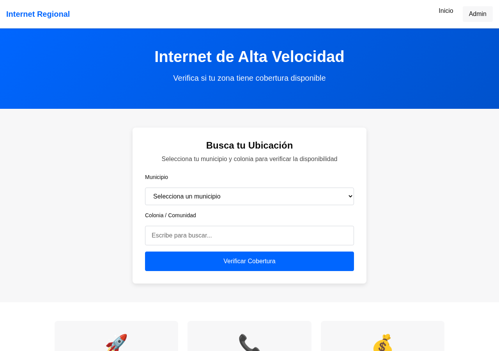
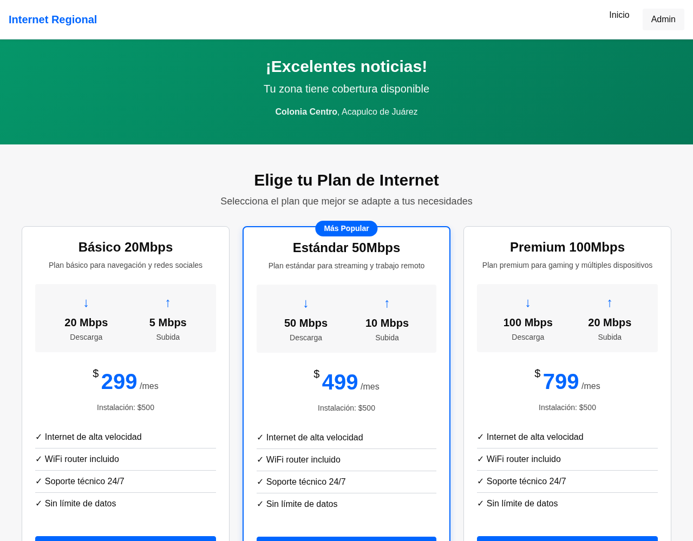

# Portal de Cobertura y Ventas para ISP

[English](README.md) · **Español**


Portal web para un proveedor regional de internet en México. Los prospectos verifican si su dirección tiene cobertura, comparan planes, obtienen una cotización y solicitan la instalación. El equipo administrativo gestiona las solicitudes y ve de dónde viene la demanda.

Antes del portal, cada consulta de cobertura se atendía por teléfono. El objetivo era reducir esa carga y convertir más prospectos en instalaciones.

|  |  |
|---|---|

<sub>Búsqueda de cobertura (izq.) y planes con cotización para una zona con cobertura (der.). Datos de ejemplo.</sub>

## Funcionalidades

**Portal público (pensado para móvil, con acceso desde códigos QR en carretera)**
- Búsqueda de cobertura por municipio y comunidad
- Planes y cotización de instalación para la zona elegida
- Formulario de solicitud de instalación, o registro de interés si aún no hay cobertura
- Detección de duplicados: el mismo teléfono en un periodo de 7 días se marca

**Panel administrativo**
- Inicio de sesión con **3 roles**: superadministrador, administrador y ventas (Flask-Login, bcrypt)
- Gestión de solicitudes: flujo de estados, notas, marcar como duplicada, **exportación a CSV** con filtros
- Gestión de catálogos: municipios, comunidades, zonas de cobertura, planes y precios por zona
- **Análisis de demanda**: solicitudes por municipio, comunidad y estado, zonas con y sin cobertura, comunidades con más demanda

## Stack

| Capa | Herramientas |
|---|---|
| Backend | Python 3.12, Flask 3 (application factory, 11 blueprints) |
| Datos | MySQL 8, SQLAlchemy, Alembic (Flask-Migrate) |
| Autenticación | Flask-Login, bcrypt |
| Frontend | Plantillas Jinja2, CSS con design tokens, JavaScript vanilla |
| Pruebas | pytest, pytest-flask, pytest-cov |

Arquitectura: `models/` (9 modelos SQLAlchemy) → `services/` (lógica de negocio) → `routes/` (blueprints) → `templates/`.

## Cómo correrlo

Requisitos: Python 3.12+ y MySQL 8+.

```bash
git clone https://github.com/angel-valencia-c/isp-coverage-portal.git
cd isp-coverage-portal
python3 -m venv venv && source venv/bin/activate
pip install -r requirements.txt

cp .env.example .env        # configura SECRET_KEY y DATABASE_URL
```

Crea la base de datos y carga el esquema y los datos de ejemplo:

```sql
CREATE DATABASE isp_portal CHARACTER SET utf8mb4 COLLATE utf8mb4_unicode_ci;
```

```bash
flask db upgrade            # aplica las migraciones
flask seed                  # municipios, planes y un usuario admin de ejemplo
flask run                   # http://localhost:5000  (admin en /admin/login)
```

El seed crea una cuenta de administrador de ejemplo (ver `seeds/initial_data.py`). Cambia su contraseña antes de cualquier despliegue real.

## Pruebas

Las pruebas usan SQLite en memoria, así que no necesitan un servidor MySQL:

```bash
pytest                      # 220 pruebas
pytest --cov=app --cov-report=html
```

## Estructura

```
app/
├── models/        # 9 modelos SQLAlchemy (cobertura, planes, solicitudes, usuarios…)
├── services/      # lógica de negocio, un servicio por módulo
├── routes/        # portal público + blueprints del panel
├── templates/     # Jinja2: layouts público y administrativo
migrations/        # migraciones Alembic
seeds/             # datos de ejemplo
tests/             # 18 archivos pytest, 220 pruebas
public/            # CSS (design tokens) y JavaScript
```

## Equipo

Desarrollado por un equipo de 3 personas para un ISP regional (nombre del cliente reservado). El proyecto siguió un proceso por fases guiado por especificaciones, con agentes de IA; las especificaciones y los roles de los agentes están en [`.agents/`](.agents/).

## Licencia

Todos los derechos reservados. Código publicado como muestra de portafolio con permiso del cliente.
