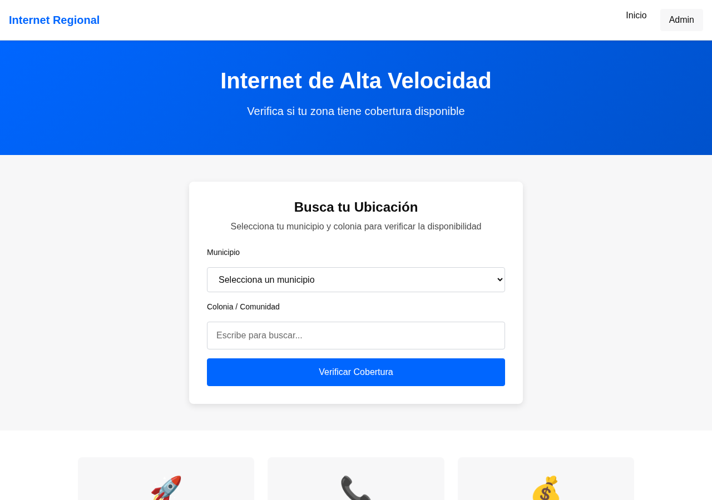
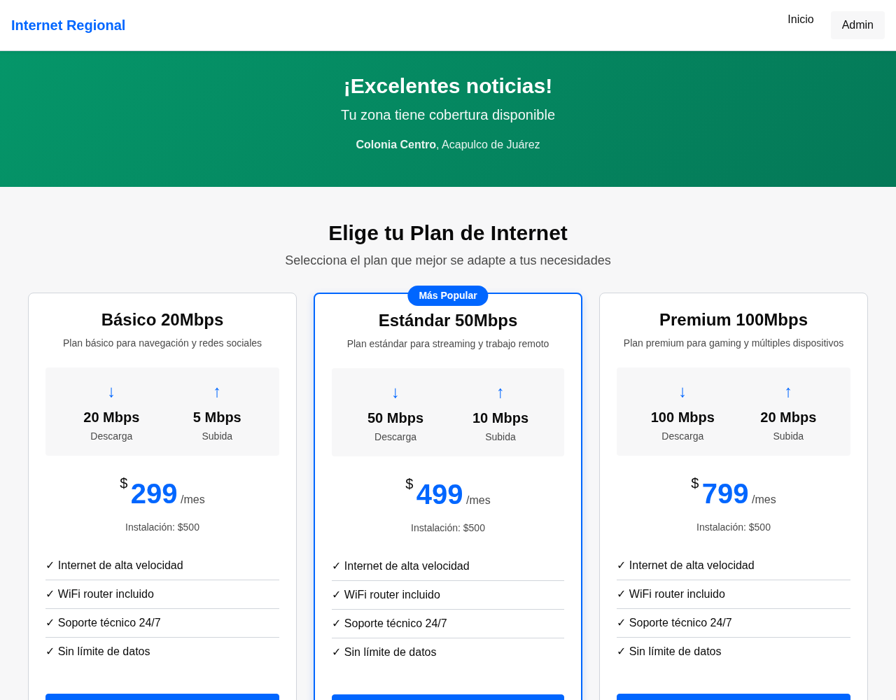

# ISP Coverage & Sales Portal

**English** · [Español](README.es.md)


Web portal for a regional internet service provider in Mexico. Prospective customers check whether their address has coverage, compare plans, get a price quote and request an installation. Staff manage the incoming requests and see where demand is coming from.

Before the portal, every coverage question was answered by phone. The goal was to cut that workload and turn more prospects into installations.

|  |  |
|---|---|

<sub>Coverage search (left) and plans with installation quote for a covered area (right). Demo data.</sub>

## Features

**Public portal (mobile-first, reachable from QR codes on roadside signs)**
- Coverage search by municipality and community
- Plans and installation price quote for the selected area
- Installation request form, or a "notify me" lead when there is no coverage yet
- Duplicate check: the same phone number within 7 days is flagged

**Admin panel**
- Login with **3 roles**: super admin, admin and sales (Flask-Login, bcrypt)
- Request management: status workflow, notes, mark as duplicate, **CSV export** with filters
- Catalog management: municipalities, communities, coverage zones, plans and per-zone pricing
- **Demand analytics**: requests by municipality, community and status, covered vs. uncovered areas, top communities

## Tech stack

| Layer | Tools |
|---|---|
| Backend | Python 3.12, Flask 3 (application factory, 11 blueprints) |
| Data | MySQL 8, SQLAlchemy, Alembic (Flask-Migrate) |
| Auth | Flask-Login, bcrypt |
| Frontend | Jinja2 templates, CSS with design tokens, vanilla JavaScript |
| Testing | pytest, pytest-flask, pytest-cov |

Architecture: `models/` (9 SQLAlchemy models) → `services/` (business logic) → `routes/` (blueprints) → `templates/`.

## Getting started

Requirements: Python 3.12+ and MySQL 8+.

```bash
git clone https://github.com/angel-valencia-c/isp-coverage-portal.git
cd isp-coverage-portal
python3 -m venv venv && source venv/bin/activate
pip install -r requirements.txt

cp .env.example .env        # set SECRET_KEY and DATABASE_URL
```

Create the database and load the schema and demo data:

```sql
CREATE DATABASE isp_portal CHARACTER SET utf8mb4 COLLATE utf8mb4_unicode_ci;
```

```bash
flask db upgrade            # apply migrations
flask seed                  # demo municipalities, plans and an admin user
flask run                   # http://localhost:5000  (admin at /admin/login)
```

The seed creates a demo admin account (see `seeds/initial_data.py`). Change its password before any real deployment.

## Tests

The test suite uses an in-memory SQLite database, so it needs no MySQL server:

```bash
pytest                      # 220 tests
pytest --cov=app --cov-report=html
```

## Project structure

```
app/
├── models/        # 9 SQLAlchemy models (coverage, plans, requests, users…)
├── services/      # business logic, one service per module
├── routes/        # public portal + admin blueprints
├── templates/     # Jinja2: public and admin layouts
migrations/        # Alembic migrations
seeds/             # demo data
tests/             # 18 pytest files, 220 tests
public/            # CSS (design tokens) and JavaScript
```

## Team

Built by a team of 3 for a regional ISP (client name withheld). The project followed a phased, spec-driven process with AI coding agents; the specs and agent roles are in [`.agents/`](.agents/).

## License

All rights reserved. Code published as a portfolio sample with the client's permission.
